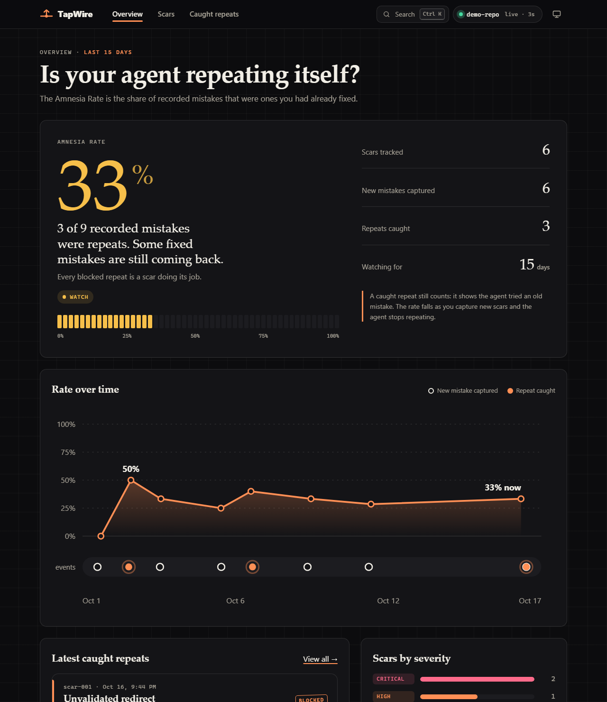
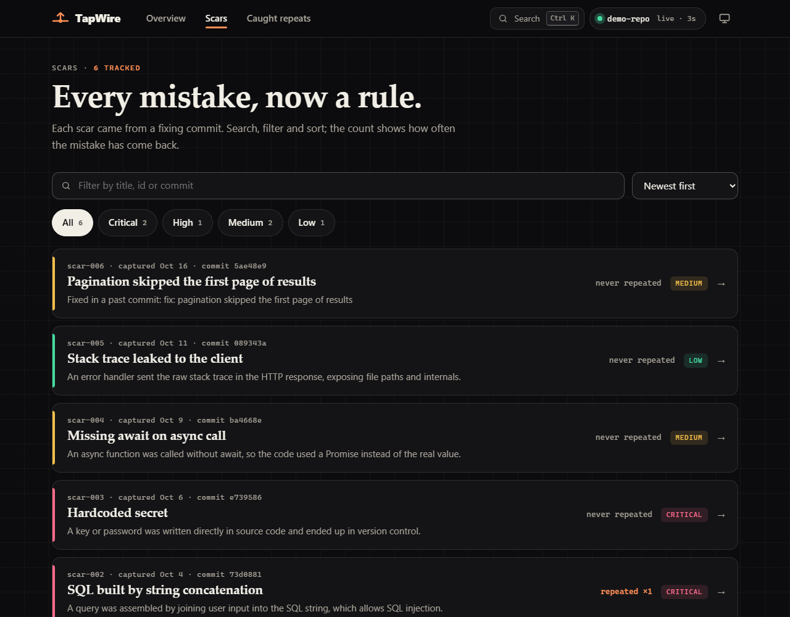
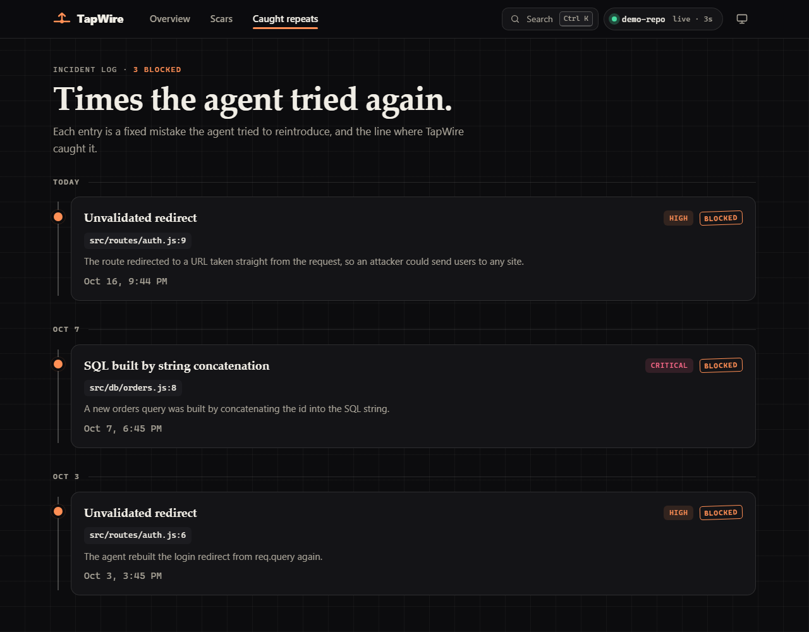
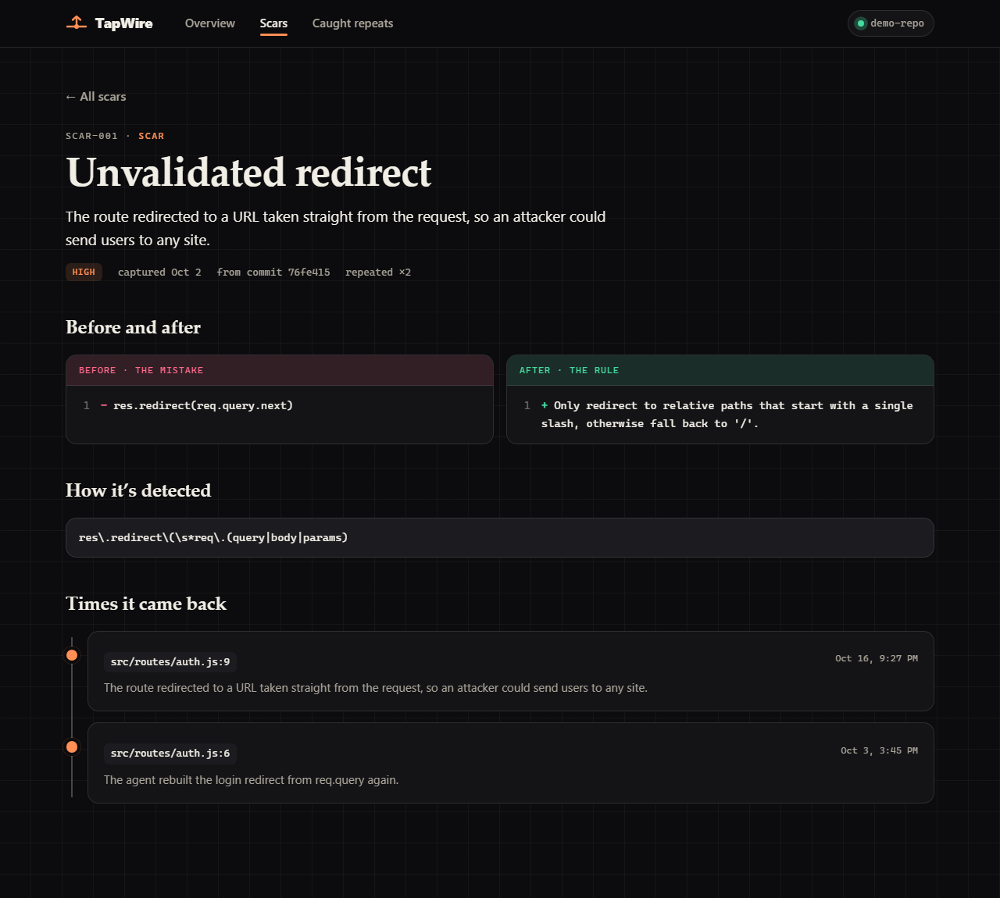
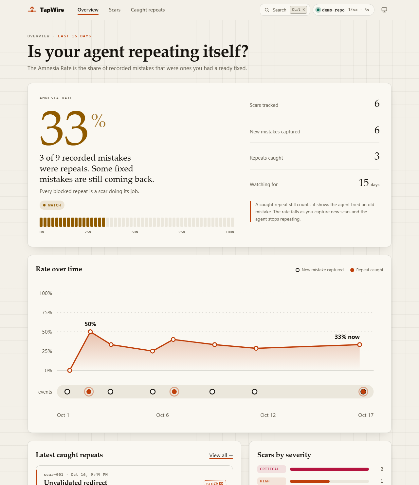
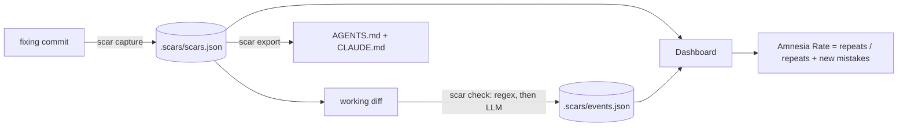

# TapWire

**Turns every mistake an AI coding agent makes into a permanent, enforced rule, and measures how often the agent repeats fixed mistakes.**

## The problem

AI coding agents repeat bugs you already fixed and forget decisions you already made. The usual fix is a note in `AGENTS.md` or a rules file, but a note is passive: it stores a lesson, it doesn't enforce it, and it never tells you whether the agent actually learned anything.

TapWire closes that loop for beginners and solo builders who code with agents (Codex, Cursor and similar):

1. **Capture**: `scar capture <commit-sha>` reads a fixing commit and turns it into a *scar*: what went wrong, the bad pattern (with an optional regex), the correct pattern and a severity.
2. **Guard**: `scar check` reads your working or staged diff and flags code that reintroduces a scar, with the file, line and reason. Regex first (fast, offline), then an LLM pass for semantic matches. A hit exits non-zero, so it can block a commit.
3. **Feed back**: `scar export` writes a managed "Scars" section into `AGENTS.md` and `CLAUDE.md`, so the agent reads past mistakes before it codes.
4. **Measure**: the dashboard shows the **Amnesia Rate** = repeats ÷ (repeats + new mistakes), over time.



<table>
  <tr>
    <td></td>
    <td></td>
  </tr>
  <tr>
    <td></td>
    <td></td>
  </tr>
</table>

*Screenshots show the generated demo repo; its history is sample data.*

## 30-second quickstart

You need Node 20+ and git. No API key is required: the demo runs in mock mode.

```bash
npm install && npm run demo
```

This builds `demo-repo/` (a tiny Express app with a real git history, five scars and about two weeks of sample events) and starts the dashboard at <http://localhost:3000>.

Then, in a second terminal, play the story:

```bash
npm run demo:capture   # capture a scar from the newest fix commit (rate goes down)
npm run demo:repeat    # a scripted "agent" repeats a fixed mistake; scar check blocks it
```

Refresh the dashboard: the new scar appears in **Scars**, the blocked repeat appears in **Caught repeats**, and the Amnesia Rate gauge and trend move. The seeded history in `demo-repo/.scars/` is sample data, not real usage.

Re-run `npm run demo:setup` at any time to rebuild the demo from scratch.

**Dashboard touches worth trying**
- **Live updates:** the page re-reads `.scars/` every few seconds, so run `npm run demo:repeat` with the Overview open and watch the rate change without reloading. Pause it with the repo pill in the top bar.
- **Inspect the chart:** hover it (or focus it and use the arrow keys) to see any day's rate and what happened that day.
- **Search anything:** press `/` or `Ctrl`/`⌘` + `K` to jump to a page or a scar.
- **Try it:** open `/try`, paste code (or pick an example) and see which scars it trips, line by line, with no terminal. Nothing is saved.
- **Scars page:** filter by text and severity, and sort by newest, most repeated or most severe.
- **Copy as agent rule:** on a scar, copy a ready-made rule to paste into your agent's instructions.
- **Light, dark or system theme** from the toggle in the top bar.

### Using it on your own repo

```bash
npm run scar -- --repo /path/to/your/repo capture <commit-sha>
npm run scar -- --repo /path/to/your/repo check            # or: check --staged
npm run scar -- --repo /path/to/your/repo export
SCAR_REPO=/path/to/your/repo npm run dev --workspace @scar/dashboard
```

`scar check` exits `1` when it finds a repeat, `0` when clean and `2` on errors, so it can be used in a CI step.

To block bad commits automatically, install the pre-commit hook:

```bash
npm run scar -- --repo /path/to/your/repo hook install     # remove with: hook uninstall
```

The hook runs `scar check --staged` before every commit and refuses the commit if a scar comes back (bypass once with `git commit --no-verify`). It never overwrites a pre-commit hook it did not write.

## Mock mode (no API key)

Set `SCAR_MOCK=1` and every LLM step uses built-in fixtures instead of the API:

- `capture` recognises the demo's known mistakes from the fixing diff, and otherwise builds a generic scar from the commit message and diff.
- `check` replaces the semantic LLM pass with a whitespace- and quote-insensitive match of each scar's bad pattern.

Everything in the demo works this way. Mock mode is a stand-in, not a model: for real semantic matching use live mode.

**Live mode:** copy `.env.example` to `.env`, set `ANTHROPIC_API_KEY`, and make sure `SCAR_MOCK` is unset. The key is only ever read from the environment. Live mode was not exercised against the real API while building this project (there was no key in the build environment), so treat it as untested. `SCAR_MODEL` overrides the model id.

## Architecture

```
            git repo you work in
   ┌──────────────────────────────────────┐
   │ fixing commit ─► scar capture ──┐    │
   │ working diff  ─► scar check  ───┼──► .scars/scars.json   (what went wrong)
   │ scars         ─► scar export ───┘    │   .scars/events.json  (new_mistake | repeat)
   │            AGENTS.md / CLAUDE.md ◄───┘
   └──────────────────────────────────────┘
                      │ reads the same files
                      ▼
          Next.js dashboard (apps/dashboard)
   Overview · Scars · Scar detail · Caught repeats
```



| Path | What it is |
| --- | --- |
| `packages/core` | types, `.scars/` store, matcher, rate and trend maths, LLM client with mock fixtures |
| `packages/cli` | the `scar` command |
| `apps/dashboard` | Next.js App Router dashboard (reads `.scars/` of the repo in `SCAR_REPO`) |
| `demo/` | scripts that build `demo-repo/` and play the capture and repeat scenes |
| `devpost/` | the planning documents: scope, PRD, spec and build checklist |

Data model: `scars.json` holds `{ id, title, whatWentWrong, badPattern, badRegex?, goodPattern, severity, sourceCommit, createdAt }`; `events.json` holds `{ id, type, scarId, file?, line?, reason?, at }`. Both are plain JSON in the repo.

## Tests

```bash
npm test               # matcher, diff parser, Amnesia Rate, trend, export, hook, mock capture
npm run typecheck
npm run a11y:contrast  # WCAG AA contrast audit of every dashboard text colour, light and dark
```

The dashboard follows the system light/dark setting (with a manual toggle), keeps every interactive target at least 44px, shows visible focus rings, supports full keyboard use including the chart, and turns off its animations when reduced motion is requested.

## How it was built

TapWire was built with the Devpost Learn *Build With AI: Basics* skill pack, in order: `1-start` (learner profile), `2-scope`, `3-prd`, `4-spec`, `5-build` and `6-ship`. The documents those skills produced are in [`devpost/`](devpost/): [scope](devpost/scope.md), [PRD](devpost/prd.md), [spec](devpost/spec.md) and the [build checklist](devpost/checklist.md). The build followed the checklist's seven slices, each verified and committed in turn. The pack is licensed separately and is not vendored in this repository.

The interview steps of those skills were answered from a written project brief rather than a live conversation.

## What the build surfaced

Observations from building it, not a substitute for the author's own reflection:

- Regex catches a mistake only in the shape it was first seen; the LLM pass exists for reworded versions. The mock stand-in only normalises whitespace and quotes, so it is deliberately less capable.
- A blocked repeat still counts as a repeat event, so the Amnesia Rate rises when the guard fires and falls when new scars are captured. It measures how often the agent *tries* to repeat a fixed mistake, not how often a repeat reaches the codebase.
- An early version of the mock semantic matcher flagged the corrected code as a repeat; a test now pins that case.

## Disclosures

- No pre-existing code: the repository was started fresh for this hackathon.
- Demo data (`demo-repo/`) is generated and seeded; its event history is sample data.
- Third-party libraries: Next.js, React, commander, vitest, tsx, TypeScript and `@anthropic-ai/sdk`, all under their own licences.

## License

[MIT](LICENSE)
