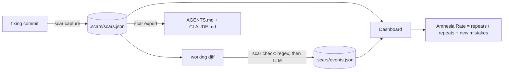

# TapWire

**Turns every mistake an AI coding agent makes into a permanent, enforced rule, and measures how often the agent repeats fixed mistakes.**

**Live demo: https://tapwire-xi.vercel.app** (the hosted dashboard shows bundled sample data; paste code on its [Try it](https://tapwire-xi.vercel.app/try) page to see a scar catch a repeat)

## The problem

AI coding agents repeat bugs you already fixed and forget decisions you already made. The usual fix is a note in `AGENTS.md` or a rules file, but a note is passive: it stores a lesson, it doesn't enforce it, and it never tells you whether the agent actually learned anything.

TapWire closes that loop for beginners and solo builders who code with agents (Codex, Cursor and similar):

1. **Capture**: `scar capture <commit-sha>` reads a fixing commit and turns it into a *scar*: what went wrong, the bad pattern (with an optional regex), the correct pattern and a severity.
2. **Guard**: `scar check` reads your working or staged diff and flags code that reintroduces a scar, with the file, line and reason. Regex first (fast, offline), then an LLM pass for semantic matches. A hit exits non-zero, so it can block a commit.
3. **Feed back**: `scar export` writes a managed "Scars" section into `AGENTS.md` and `CLAUDE.md`, so the agent reads past mistakes before it codes.
4. **Measure**: the dashboard shows the **Amnesia Rate** = repeats ÷ (repeats + new mistakes), over time.


<table>
  <tr>
    <td></td>
    <td></td>
  </tr>
  <tr>
    <td></td>
    <td></td>
  </tr>
</table>

*Screenshots show the generated demo repo; its history is sample data.*

## 30-second quickstart

You need Node 20+ and git. No API key is required: the demo runs in mock mode.

```bash
npm install && npm run demo
```

This builds `demo-repo/` (a tiny Express app with a real git history, five scars and about two weeks of sample events) and starts the dashboard at <http://localhost:3000>.

Then, in a second terminal, play the story:

```bash
npm run demo:capture   # capture a scar from the newest fix commit (rate goes down)
npm run demo:repeat    # a scripted "agent" repeats a fixed mistake; scar check blocks it
```

Refresh the dashboard: the new scar appears in **Scars**, the blocked repeat appears in **Caught repeats**, and the Amnesia Rate gauge and trend move. The seeded history in `demo-repo/.scars/` is sample data, not real usage.

Re-run `npm run demo:setup` at any time to rebuild the demo from scratch.

**Dashboard touches worth trying**
- **Live updates:** the page re-reads `.scars/` every few seconds, so run `npm run demo:repeat` with the Overview open and watch the rate change without reloading. Pause it with the repo pill in the top bar.
- **Inspect the chart:** hover it (or focus it and use the arrow keys) to see any day's rate and what happened that day.
- **Search anything:** press `/` or `Ctrl`/`⌘` + `K` to jump to a page or a scar.
- **Try it:** open `/try`, paste code (or pick an example) and see which scars it trips, line by line, with no terminal. Nothing is saved.
- **Scars page:** filter by text and severity, and sort by newest, most repeated or most severe.
- **Copy as agent rule:** on a scar, copy a ready-made rule to paste into your agent's instructions.
- **Light, dark or system theme** from the toggle in the top bar.

## Use TapWire in your own project

You need Node 20+ and git. TapWire works in any git repository and any language, because it reads your diffs.

### 1. Install

```bash
npm install -g https://github.com/Kaushik2210/tapwire/releases/download/v0.1.1/kaushik2210-tapwire-0.1.1.tgz
tapwire --version
```

This gives you the `tapwire` command (and the short alias `scar`). The package is not on the npm registry yet; the release file above is the install source. To use the AI features, set `ANTHROPIC_API_KEY` in your environment or in a local `.env` file (keep it out of git). Without a key, `check --offline` still works.

### 2. Set up once per repository

```bash
cd your-repo
tapwire init
```

`init` creates the `.scars/` store (commit it, so your team shares the scars), installs a pre-commit hook, and adds a "Scars" section to `AGENTS.md` and `CLAUDE.md`, which AI coding agents read before they work.

### 3. The everyday loop

1. Your AI (or you) writes a bug, and you fix it and commit the fix as usual.
2. `tapwire capture <commit-sha> --export` turns that fix into a scar and refreshes the agent's instructions.
3. From then on, if that mistake comes back, the commit is blocked and the line is named. `tapwire status` shows the Amnesia Rate and whether everything is wired up; the dashboard shows it over time.

### 4. Where the mistake gets stopped

A scar works at three points, from soft to hard:

| Layer | What happens | Can it be skipped? |
| --- | --- | --- |
| **Agent instructions** | `AGENTS.md` and `CLAUDE.md` list the past mistakes and tell the agent to run `scar check` before finishing. | Yes: an agent can ignore them. |
| **Self-check** | The agent (or you) runs `tapwire check`. It exits `1` and prints the file, line, reason and the correct pattern. | Yes: only if nobody runs it. |
| **Pre-commit hook / CI** | `tapwire check --staged` runs on every commit, and `tapwire check --base origin/main` can fail a pull request. | A developer can bypass the hook with `git commit --no-verify`; CI cannot be bypassed by a local commit. |

### 5. Block it in CI

```yaml
# .github/workflows/tapwire.yml  (example; the --base logic is tested, this workflow file has not been run on GitHub)
name: TapWire
on: pull_request
jobs:
  check:
    runs-on: ubuntu-latest
    steps:
      - uses: actions/checkout@v4
        with:
          fetch-depth: 0          # TapWire needs the base branch history
      - run: npm install -g https://github.com/Kaushik2210/tapwire/releases/download/v0.1.1/kaushik2210-tapwire-0.1.1.tgz
      - run: tapwire check --base origin/${{ github.base_ref }} --offline
```

Use `--offline` in CI and hooks unless you want an LLM request on every run; drop it to also run the semantic pass (set `ANTHROPIC_API_KEY` as a secret).

### Commands

| Command | What it does |
| --- | --- |
| `tapwire init [--no-hook] [--semantic]` | Set up the store, hook and agent notes. |
| `tapwire capture <sha> [--export]` | Turn a fixing commit into a scar. |
| `tapwire check [--staged] [--base <ref>] [--offline] [--json] [--no-record]` | Flag repeats; exit `1` if found, `2` on a tool error. |
| `tapwire status` | Show setup, scar count, Amnesia Rate and AI mode. |
| `tapwire export` | Refresh the Scars section in `AGENTS.md` and `CLAUDE.md`. |
| `tapwire hook install [--semantic]` / `hook uninstall` | Manage the pre-commit hook (only ever removes its own). |

### What this can and cannot do

TapWire cannot stop an AI from *writing* a mistake: it has no control over the model. What it does is make a repeat of a **known, fixed** mistake get noticed, named and blocked before it lands, tell the agent about it up front, and measure how often it happens. Be realistic about its limits:

- It only knows mistakes you have captured. A new kind of bug is a new mistake, not a repeat.
- Detection is only as good as the pattern. Regex catches a mistake in the shape it was first seen; the optional LLM pass looks for reworded versions and can miss some or flag false positives (see "Mock mode" below for what has and has not been tested).
- The hook is a safety net for honest workflows, not a security boundary: `--no-verify` bypasses it.
- The hook only blocks when a repeat is found. If the tool itself fails (missing, crashed, or no network), the commit is allowed and a warning is printed, so TapWire can never stop someone from committing.
- Files TapWire manages (`.scars/`, `AGENTS.md`, `CLAUDE.md`) are never checked, because they quote the bad patterns on purpose.

`npm run test:install` proves the install path: it packs the CLI, installs it into an empty project, and runs this whole workflow on a fresh repository with real `git commit` calls.

### Working on this repository itself

From a clone, the same commands run as `npm run scar -- --repo /path/to/repo <command>`, and the dashboard reads a repository with `SCAR_REPO=/path/to/repo npm run dev --workspace @scar/dashboard`.

## Mock mode (no API key)

Set `SCAR_MOCK=1` and every LLM step uses built-in fixtures instead of the API:

- `capture` recognises the demo's known mistakes from the fixing diff, and otherwise builds a generic scar from the commit message and diff.
- `check` replaces the semantic LLM pass with a whitespace- and quote-insensitive match of each scar's bad pattern.

Everything in the demo works this way. Mock mode is a stand-in, not a model: for real semantic matching use live mode.

**Live mode:** copy `.env.example` to `.env`, set `ANTHROPIC_API_KEY`, and make sure `SCAR_MOCK` is unset. The key is only ever read from the environment. `SCAR_MODEL` overrides the model id.

What has and has not been tested in live mode:
- **Tested:** the live code path runs against a local stand-in for the Anthropic Messages API (`packages/core/test/live.test.ts`, 13 tests). The real SDK makes real HTTP requests to it, so the key and model are sent, the diff is included, replies are parsed (including fenced or chatty JSON), bad replies and API failures are handled, and `check` falls back to regex results with a notice.
- **Not yet verified:** how well the real model writes scars and spots reworded repeats. Run `npm run live:test` with your own key to find out: it makes about four requests, asserts the hard requirements (a complete scar, the same mistake caught in a new file, corrected and unrelated code left alone) and reports model-dependent checks as warnings.

## Deploy the dashboard

It is deployed at https://tapwire-xi.vercel.app (Vercel, root directory `apps/dashboard`, no environment variables; every push to `main` redeploys). The dashboard is a standard Next.js app, and it needs no database or API key to show the demo: when no repository is configured and there is no `demo-repo/`, it shows a bundled snapshot of the demo data (`apps/dashboard/demo-data/`) and labels it "sample data". Refresh the snapshot with `npm run demo:setup && npm run demo:capture && npm run demo:repeat && npm run demo:snapshot`.

[](https://vercel.com/new/clone?repository-url=https%3A%2F%2Fgithub.com%2FKaushik2210%2Ftapwire&root-directory=apps%2Fdashboard&project-name=tapwire)

By hand on Vercel: import the repository, set **Root Directory** to `apps/dashboard`, leave the framework as Next.js, and deploy (no environment variables are needed). To point a deployed dashboard at real data instead, set `SCAR_REPO` to a path the server can read.

The hosted dashboard shows sample data only. Capture, check and export are CLI features that run against a local repository.

## Architecture

```
            git repo you work in
   ┌──────────────────────────────────────┐
   │ fixing commit ─► scar capture ──┐    │
   │ working diff  ─► scar check  ───┼──► .scars/scars.json   (what went wrong)
   │ scars         ─► scar export ───┘    │   .scars/events.json  (new_mistake | repeat)
   │            AGENTS.md / CLAUDE.md ◄───┘
   └──────────────────────────────────────┘
                      │ reads the same files
                      ▼
          Next.js dashboard (apps/dashboard)
   Overview · Scars · Scar detail · Caught repeats
```



| Path | What it is |
| --- | --- |
| `packages/core` | types, `.scars/` store, matcher, rate and trend maths, LLM client with mock fixtures |
| `packages/cli` | the `scar` command |
| `apps/dashboard` | Next.js App Router dashboard (reads `.scars/` of the repo in `SCAR_REPO`) |
| `demo/` | scripts that build `demo-repo/` and play the capture and repeat scenes |
| `devpost/` | the planning documents: scope, PRD, spec and build checklist |

Data model: `scars.json` holds `{ id, title, whatWentWrong, badPattern, badRegex?, goodPattern, severity, sourceCommit, createdAt }`; `events.json` holds `{ id, type, scarId, file?, line?, reason?, at }`. Both are plain JSON in the repo.

## Tests

```bash
npm test               # matcher, diff parser, Amnesia Rate, trend, export, hook, mock capture
npm run typecheck
npm run test:install   # packs the CLI, installs it into an empty project and runs the whole workflow with real git commits
npm run a11y:contrast  # WCAG AA contrast audit of every dashboard text colour, light and dark
```

The dashboard follows the system light/dark setting (with a manual toggle), keeps every interactive target at least 44px, shows visible focus rings, supports full keyboard use including the chart, and turns off its animations when reduced motion is requested.

## How it was built

TapWire was built with the Devpost Learn *Build With AI: Basics* skill pack, in order: `1-start` (learner profile), `2-scope`, `3-prd`, `4-spec`, `5-build` and `6-ship`. The documents those skills produced are in [`devpost/`](devpost/): [scope](devpost/scope.md), [PRD](devpost/prd.md), [spec](devpost/spec.md) and the [build checklist](devpost/checklist.md). The build followed the checklist's seven slices, each verified and committed in turn. The pack is licensed separately and is not vendored in this repository.

The interview steps of those skills were answered from a written project brief rather than a live conversation.

## What the build surfaced

Observations from building it, not a substitute for the author's own reflection:

- Regex catches a mistake only in the shape it was first seen; the LLM pass exists for reworded versions. The mock stand-in only normalises whitespace and quotes, so it is deliberately less capable.
- A blocked repeat still counts as a repeat event, so the Amnesia Rate rises when the guard fires and falls when new scars are captured. It measures how often the agent *tries* to repeat a fixed mistake, not how often a repeat reaches the codebase.
- An early version of the mock semantic matcher flagged the corrected code as a repeat; a test now pins that case.

## Disclosures

- No pre-existing code: the repository was started fresh for this hackathon.
- Demo data (`demo-repo/`) is generated and seeded; its event history is sample data.
- Third-party libraries: Next.js, React, commander, vitest, tsx, TypeScript and `@anthropic-ai/sdk`, all under their own licences.

## License

[MIT](LICENSE)
